<a href="https://yanhong386.github.io/YANHONG386/">
<picture>
  <source media="(max-width: 600px) and (prefers-color-scheme: dark)" srcset="./assets/readme-v5/hero-mobile-dark.svg">
  <source media="(max-width: 600px)" srcset="./assets/readme-v5/hero-mobile-light.svg">
  <source media="(prefers-color-scheme: dark)" srcset="./assets/readme-v5/hero-dark.svg">
  
</picture>
</a>

[完整交互主页 ↗](https://yanhong386.github.io/YANHONG386/) · [个人博客 ↗](https://yhong386.com)

## `01` 关于我 / About

你好，我是 **YANHONG386**，目前从事全栈开发工作，关注工程质量与产品体验。

使用 **Java / Spring** 构建服务，也使用 **Vue / React** 完成前端体验；同时探索 **AI Agent、Prompt Engineering** 与自动化工作流。

`WORK` 全栈开发　·　`OTAKU` 重度二次元　·　`GAMING` 深度游戏玩家

## `02` 我的世界 / My World

<picture>
  <source media="(max-width: 600px) and (prefers-color-scheme: dark)" srcset="./assets/readme-v5/world-mobile-dark.svg">
  <source media="(max-width: 600px)" srcset="./assets/readme-v5/world-mobile-light.svg">
  <source media="(prefers-color-scheme: dark)" srcset="./assets/readme-v5/world-dark.svg">
  
</picture>

## `03` 个人博客 / Blog

<a href="https://yhong386.com">
<picture>
  <source media="(max-width: 600px) and (prefers-color-scheme: dark)" srcset="./assets/readme-v5/blog-mobile-dark.svg">
  <source media="(max-width: 600px)" srcset="./assets/readme-v5/blog-mobile-light.svg">
  <source media="(prefers-color-scheme: dark)" srcset="./assets/readme-v5/blog-dark.svg">
  
</picture>
</a>

## `04` 技术栈 / Stack

<picture>
  <source media="(max-width: 600px) and (prefers-color-scheme: dark)" srcset="./assets/readme-v5/stack-mobile-dark.svg">
  <source media="(max-width: 600px)" srcset="./assets/readme-v5/stack-mobile-light.svg">
  <source media="(prefers-color-scheme: dark)" srcset="./assets/readme-v5/stack-dark.svg">
  
</picture>

展开技术栈与开发方向

**Java · Spring · Python · JavaScript · Vue · React · MySQL · Redis · Docker · Maven · Linux · Git**

`BACKEND` Java · Spring · MyBatis 
`FRONTEND` Vue · React · JavaScript 
`DATA` MySQL · Redis · RabbitMQ 
`AI / OPS` Agent · Dify · Docker · Linux

## `05` 找到我 / Connect

<a href="https://yhong386.com"><picture>
  <source media="(max-width: 600px) and (prefers-color-scheme: dark)" srcset="./assets/readme-v5/contact-blog-mobile-dark.svg">
  <source media="(max-width: 600px)" srcset="./assets/readme-v5/contact-blog-mobile-light.svg">
  <source media="(prefers-color-scheme: dark)" srcset="./assets/readme-v5/contact-blog-dark.svg">
  
</picture></a>
<a href="mailto:zhazhiji4@163.com"><picture>
  <source media="(max-width: 600px) and (prefers-color-scheme: dark)" srcset="./assets/readme-v5/contact-email-mobile-dark.svg">
  <source media="(max-width: 600px)" srcset="./assets/readme-v5/contact-email-mobile-light.svg">
  <source media="(prefers-color-scheme: dark)" srcset="./assets/readme-v5/contact-email-dark.svg">
  
</picture></a>
<a href="https://steamcommunity.com/id/yhong386/"><picture>
  <source media="(max-width: 600px) and (prefers-color-scheme: dark)" srcset="./assets/readme-v5/contact-steam-mobile-dark.svg">
  <source media="(max-width: 600px)" srcset="./assets/readme-v5/contact-steam-mobile-light.svg">
  <source media="(prefers-color-scheme: dark)" srcset="./assets/readme-v5/contact-steam-dark.svg">
  
</picture></a>
<a href="https://space.bilibili.com/346740691"><picture>
  <source media="(max-width: 600px) and (prefers-color-scheme: dark)" srcset="./assets/readme-v5/contact-bilibili-mobile-dark.svg">
  <source media="(max-width: 600px)" srcset="./assets/readme-v5/contact-bilibili-mobile-light.svg">
  <source media="(prefers-color-scheme: dark)" srcset="./assets/readme-v5/contact-bilibili-dark.svg">
  
</picture></a>
<a href="https://qm.qq.com/q/2901394478"><picture>
  <source media="(max-width: 600px) and (prefers-color-scheme: dark)" srcset="./assets/readme-v5/contact-qq-mobile-dark.svg">
  <source media="(max-width: 600px)" srcset="./assets/readme-v5/contact-qq-mobile-light.svg">
  <source media="(prefers-color-scheme: dark)" srcset="./assets/readme-v5/contact-qq-dark.svg">
  
</picture></a>
<a href="https://github.com/YANHONG386"><picture>
  <source media="(max-width: 600px) and (prefers-color-scheme: dark)" srcset="./assets/readme-v5/contact-github-mobile-dark.svg">
  <source media="(max-width: 600px)" srcset="./assets/readme-v5/contact-github-mobile-light.svg">
  <source media="(prefers-color-scheme: dark)" srcset="./assets/readme-v5/contact-github-dark.svg">
  
</picture></a>

展开账号与联系方式

- [Blog · yhong386.com](https://yhong386.com)
- [Email · zhazhiji4@163.com](mailto:zhazhiji4@163.com)
- [Steam · yhong386](https://steamcommunity.com/id/yhong386/)
- [Bilibili · 346740691](https://space.bilibili.com/346740691)
- [QQ · 2901394478](https://qm.qq.com/q/2901394478)
- [GitHub · YANHONG386](https://github.com/YANHONG386)

---

**「在代码、动画与游戏之间，构建属于自己的世界。」**

[完整交互主页](https://yanhong386.github.io/YANHONG386/) · [个人博客](https://yhong386.com) · [GitHub](https://github.com/YANHONG386)

