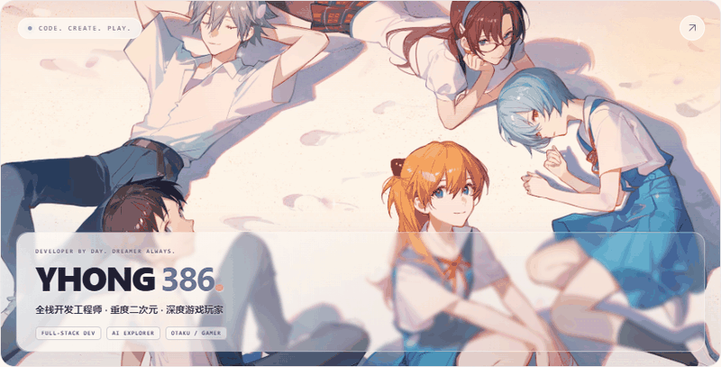
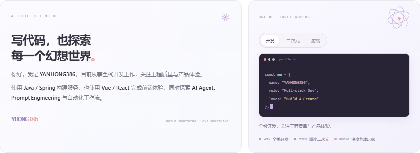
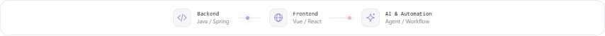
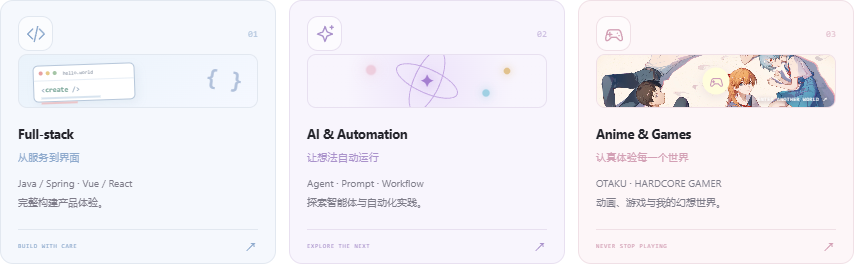
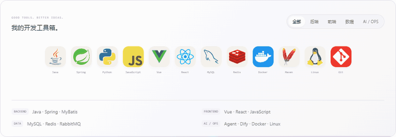
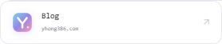
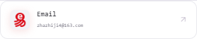
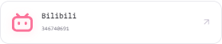
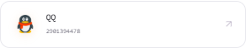
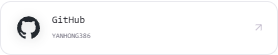

<a href="https://yanhong386.github.io/YANHONG386/">
<picture>
  <source media="(prefers-color-scheme: dark)" srcset="./assets/profile-v3/hero-dark.gif">
  <source media="(prefers-color-scheme: light)" srcset="./assets/profile-v3/hero-light.gif">
  
</picture>
</a>

**[打开完整交互主页 ↗](https://yanhong386.github.io/YANHONG386/)** · [个人博客](https://yhong386.com)

## `01` 关于我 / About

<picture>
  <source media="(prefers-color-scheme: dark)" srcset="./assets/profile-v3/about-dark.png">
  <source media="(prefers-color-scheme: light)" srcset="./assets/profile-v3/about-light.png">
  
</picture>

你好，我是 **YANHONG386**，目前从事全栈开发工作，关注工程质量与产品体验。

使用 **Java / Spring** 构建服务，也使用 **Vue / React** 完成前端体验；同时探索 **AI Agent、Prompt Engineering** 与自动化工作流。

`WORK` 全栈开发　·　`OTAKU` 重度二次元　·　`GAMING` 深度游戏玩家

<picture>
  <source media="(prefers-color-scheme: dark)" srcset="./assets/profile-v3/path-dark.png">
  <source media="(prefers-color-scheme: light)" srcset="./assets/profile-v3/path-light.png">
  
</picture>

## `02` 我的世界 / My World

<picture>
  <source media="(prefers-color-scheme: dark)" srcset="./assets/profile-v3/world-dark.png">
  <source media="(prefers-color-scheme: light)" srcset="./assets/profile-v3/world-light.png">
  
</picture>

**Full-stack** · Java / Spring、Vue / React，完整构建产品体验。 
**AI & Automation** · Agent、Prompt、Workflow，探索智能体与自动化实践。 
**Anime & Games** · 动画、游戏与我的幻想世界。

## `03` 个人博客 / Blog

我的个人博客 **[yhong386.com](https://yhong386.com)**，记录全栈开发实践、AI 探索笔记，以及二次元与游戏生活。

<a href="https://yhong386.com">
<picture>
  <source media="(prefers-color-scheme: dark)" srcset="./assets/profile-v3/blog-dark.gif">
  <source media="(prefers-color-scheme: light)" srcset="./assets/profile-v3/blog-light.gif">
  
</picture>
</a>

## `04` 技术栈 / Stack

<a href="https://yanhong386.github.io/YANHONG386/#stack-heading">
<picture>
  <source media="(prefers-color-scheme: dark)" srcset="./assets/profile-v3/stack-dark.gif">
  <source media="(prefers-color-scheme: light)" srcset="./assets/profile-v3/stack-light.gif">
  
</picture>
</a>

**Java · Spring · Python · JavaScript · Vue · React · MySQL · Redis · Docker · Maven · Linux · Git**

`BACKEND` Java · Spring · MyBatis　　`FRONTEND` Vue · React · JavaScript 
`DATA` MySQL · Redis · RabbitMQ　　`AI / OPS` Agent · Dify · Docker · Linux

## `05` 找到我 / Connect

<table>
<tr>
<td width="33%"><a href="https://yhong386.com"><picture>
  <source media="(prefers-color-scheme: dark)" srcset="./assets/profile-v3/contact-0-dark.png">
  <source media="(prefers-color-scheme: light)" srcset="./assets/profile-v3/contact-0-light.png">
  
</picture></a></td>
<td width="33%"><a href="mailto:zhazhiji4@163.com"><picture>
  <source media="(prefers-color-scheme: dark)" srcset="./assets/profile-v3/contact-1-dark.png">
  <source media="(prefers-color-scheme: light)" srcset="./assets/profile-v3/contact-1-light.png">
  
</picture></a></td>
<td width="33%"><a href="https://steamcommunity.com/id/yhong386/"><picture>
  <source media="(prefers-color-scheme: dark)" srcset="./assets/profile-v3/contact-2-dark.png">
  <source media="(prefers-color-scheme: light)" srcset="./assets/profile-v3/contact-2-light.png">
  
</picture></a></td>
</tr>
<tr>
<td width="33%"><a href="https://space.bilibili.com/346740691"><picture>
  <source media="(prefers-color-scheme: dark)" srcset="./assets/profile-v3/contact-3-dark.png">
  <source media="(prefers-color-scheme: light)" srcset="./assets/profile-v3/contact-3-light.png">
  
</picture></a></td>
<td width="33%"><a href="https://qm.qq.com/q/2901394478"><picture>
  <source media="(prefers-color-scheme: dark)" srcset="./assets/profile-v3/contact-4-dark.png">
  <source media="(prefers-color-scheme: light)" srcset="./assets/profile-v3/contact-4-light.png">
  
</picture></a></td>
<td width="33%"><a href="https://github.com/YANHONG386"><picture>
  <source media="(prefers-color-scheme: dark)" srcset="./assets/profile-v3/contact-5-dark.png">
  <source media="(prefers-color-scheme: light)" srcset="./assets/profile-v3/contact-5-light.png">
  
</picture></a></td>
</tr>
</table>

<picture>
  <source media="(prefers-color-scheme: dark)" srcset="./assets/profile-v3/footer-dark.png">
  <source media="(prefers-color-scheme: light)" srcset="./assets/profile-v3/footer-light.png">
  
</picture>

**「在代码、动画与游戏之间，构建属于自己的世界。」**

